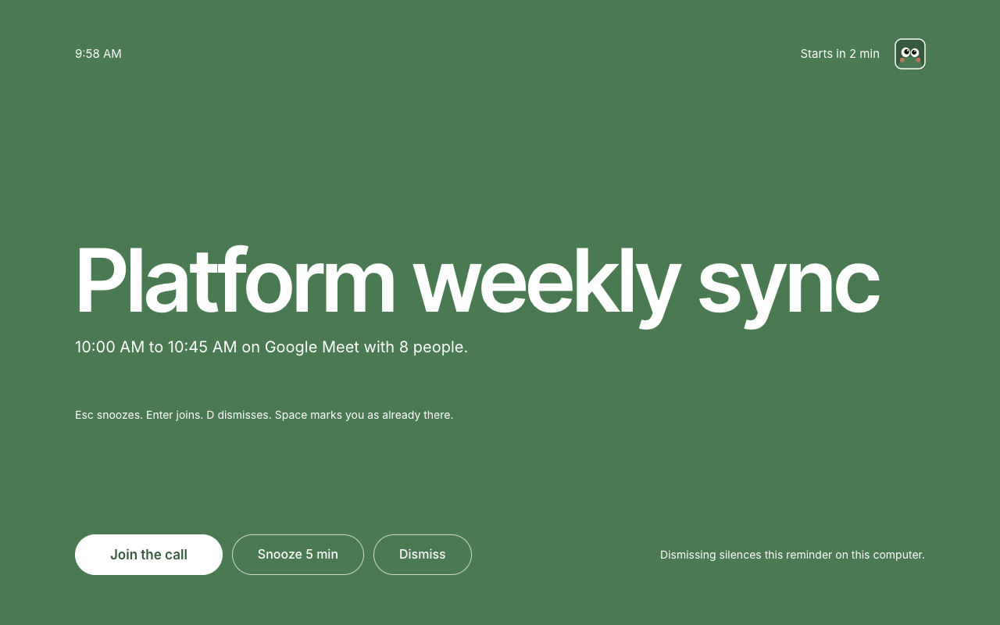
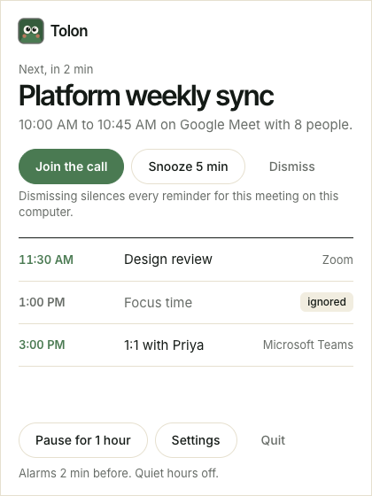
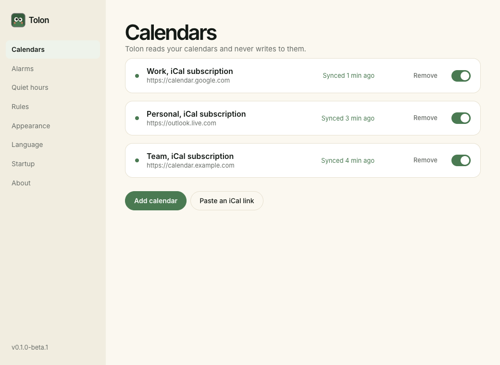
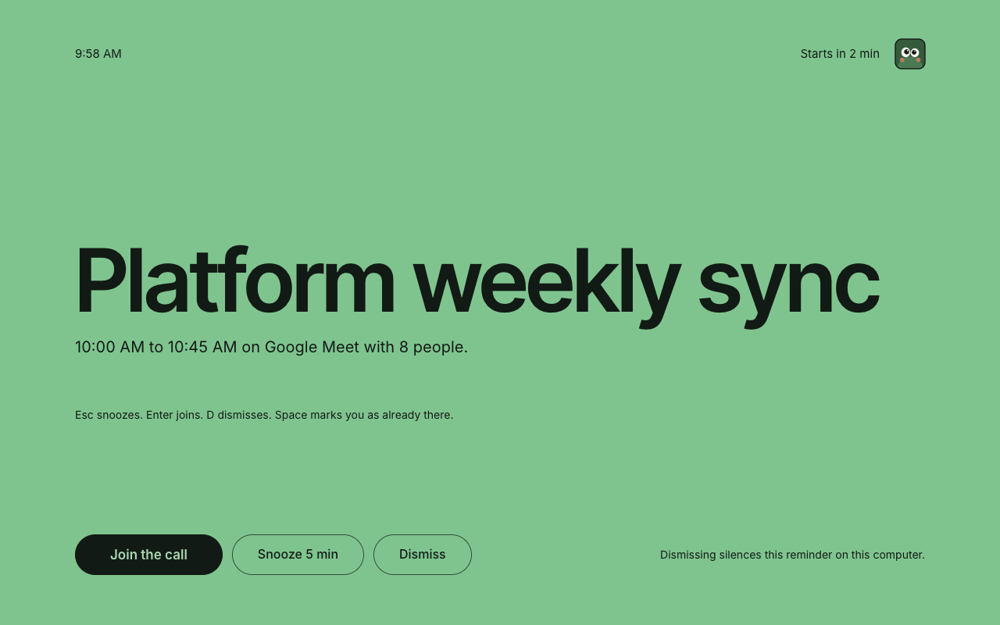
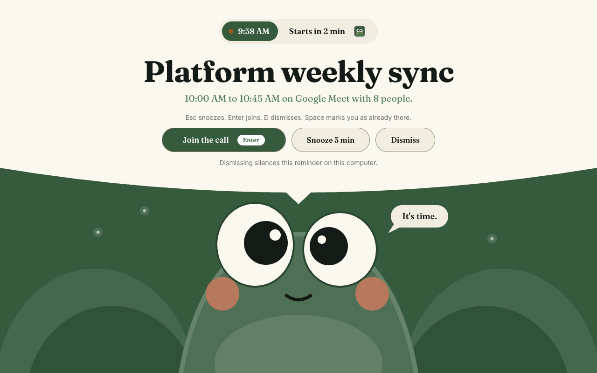
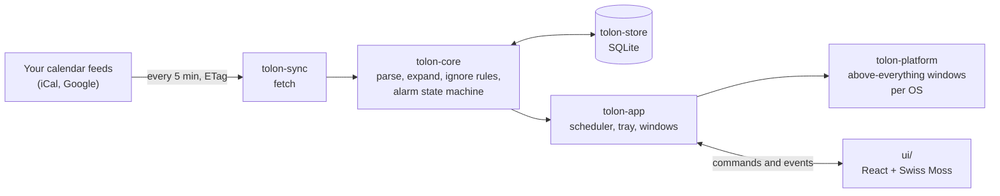

<div align="center">


# Tolon

**Never miss a meeting again.**

Tolon watches your calendars and takes over the whole screen when a meeting is about to start, so you can join it with one key.

macOS, Windows and Linux. Read only, local only, open source.

[Install](docs/install.md) · [How it works](#how-it-works) · [Contribute](CONTRIBUTING.md) · [Roadmap](#roadmap)



</div>

## Why Tolon

Notifications are easy to miss. A small banner slides in while you are deep in an editor, a document or a full-screen video, and five minutes later you are the person everyone is waiting for.

Tolon does not slide in. Two minutes before a meeting it fills every screen with the meeting's name, the time and who is in it. Press Enter to join the call, Esc to snooze, or D to dismiss. Then it gets out of the way.

## What it does

- **Full-screen reminders.** On every screen, and above full-screen apps on macOS too.
- **One key to join.** Tolon finds the link for Google Meet, Zoom, Microsoft Teams, Webex and Jitsi, and falls back to any https link in the location.
- **Your calendars, as they are.** Subscribe to any iCal address: Google's secret address, a published Outlook calendar, or any `.ics` link. Google Calendar sign-in follows in beta 2.
- **Recurring events done right.** Repeat rules, exceptions, moved occurrences and time zones, including the night the clocks change.
- **Quiet when you want it.** Pause for an hour, set quiet hours, and ignore all-day events, events you declined, or anything matching words like "Focus" or "Lunch".
- **A tray icon that knows what is next.** The next meeting and the rest of your day, one click away.
- **Light and dark.** Follows your system, or pick one.

<table>
  <tr>
    <td width="34%"></td>
    <td></td>
  </tr>
  <tr>
    <td align="center">The tray panel</td>
    <td align="center">Calendars and their sync status</td>
  </tr>
</table>

<table>
  <tr>
    <td width="50%"></td>
    <td width="50%"></td>
  </tr>
  <tr>
    <td align="center">The dark theme</td>
    <td align="center">The Peek style</td>
  </tr>
</table>

Peek is an optional style for the reminder. Turn it on under Settings, Appearance, Style.

## Design

Every screen is designed in [FigCraft](https://github.com/storytold/figcraft), an open-source interface design tool written in Rust. The working file is in this repository at [`mockups/mockups.figcraft`](mockups/mockups.figcraft). It is a work in progress, kept up to date as the design changes, and anyone can open it in FigCraft to explore it, take ideas from it, or propose changes. Colours and type come from [Swiss Moss](https://danielpsf.github.io/swiss-moss/).

## Private by design

- **Read only.** Tolon never writes to your calendars. No RSVPs, no edits.
- **Local only.** Your calendars and settings live in a SQLite file on your machine. There is no Tolon server and no account.
- **No telemetry.** Tolon sends nothing anywhere. The only network calls are to your calendar feeds and to GitHub Releases for updates.
- **Secrets stay secret.** Private calendar addresses are stored only in the local database and are stripped from every log line.
- **Signed updates.** Every update is checked against the project's signing key before it installs.

## Install

Beta 1 is on its way. When it is out, download the file for your system from the [Releases page](https://github.com/danielpsf/tolon/releases) and follow [the install guide](docs/install.md). It takes about two minutes, including adding your first calendar.

| System | Download |
| --- | --- |
| macOS, Apple silicon and Intel | `.dmg` (universal) |
| Windows | `.msi` or `.exe` |
| Linux | `.AppImage` or `.deb` |

Beta builds are not signed by Apple or by a Windows certificate authority yet, so your system asks you to confirm once. The install guide walks you through it.

Tolon needs an iCal link to your calendar. [This guide](docs/help/ical-links.md) shows where to find it in Outlook.com, Google Calendar and Yahoo Calendar.

## How it works



Tolon is a [Tauri 2](https://tauri.app) app: a Rust core with a small React view on top.

- **Sync** fetches each calendar every five minutes and asks the server whether anything changed first, so a quiet calendar costs one tiny request.
- **Core** turns raw `.ics` data into the meetings of the next seven days: time zones, repeat rules, exceptions, cancelled and declined events. It has no I/O, which keeps it fast to test.
- **The scheduler** plans each alarm, fires it once, and remembers snoozes and dismissals across restarts.
- **Platform** code does the per-OS work of putting a window above everything else, including full-screen apps.
- **The view** only renders what the core tells it and sends your clicks back as commands. It is styled entirely with [Swiss Moss](https://danielpsf.github.io/swiss-moss/), the project's design system.

The full design is in [docs/architecture.md](docs/architecture.md).

## Roadmap

| Milestone | What you get | Status |
| --- | --- | --- |
| M0 Skeleton | The app boots on all three systems, CI green | Done |
| M1 Calendars | Add an iCal calendar, sync it, see today's meetings | Done |
| M2 Alarms | The full-screen reminder, snooze, dismiss, join, keyboard | In progress |
| M3 Daily use | Tray panel, pause, quiet hours, ignore rules, sound, start at login | Done |
| M4 Release | Signed updates, installers, `v0.1.0-beta.1` | In progress |
| M5 Google | Google Calendar sign-in, `v0.1.0-beta.2` | Planned |

Every feature has written scenarios and acceptance criteria in [docs/plan.md](docs/plan.md), and the live task list is [docs/ledger.md](docs/ledger.md).

## Build from source

You need Rust (the version is pinned in `rust-toolchain.toml`), Node 22, and the [Tauri 2 prerequisites](https://tauri.app/start/prerequisites/) for your system.

```sh
git clone https://github.com/danielpsf/tolon.git
cd tolon
npm --prefix ui ci
cargo run -p tolon-app       # run Tolon in development
cargo xtask ci               # the full check that every change must pass
```

On macOS and Linux, `make dev` does the same with hot reload, installing the UI dependencies first when they changed; `make ci` runs the full check.

## Contribute

Bug reports, real-world calendar feeds that break the parser (anonymised, please), and pull requests are all welcome. Start with [CONTRIBUTING.md](CONTRIBUTING.md): it covers the setup, the checks, commit conventions and the rules every change follows.

Much of Tolon is built by coding agents working from a written plan, with a human deciding what ships. If you are curious how that works, or want to use your own agent on the project, read [docs/agents/README.md](docs/agents/README.md).

## Built with

- [Tauri 2](https://tauri.app) and Rust, for a small native app on every system.
- [Swiss Moss](https://github.com/danielpsf/swiss-moss), the design system behind every pixel.
- [FigCraft](https://github.com/storytold/figcraft), where the screens are designed.

Thank you to the people who build and maintain these projects in the open.

## License

Tolon is licensed under the [Apache License 2.0](LICENSE).
