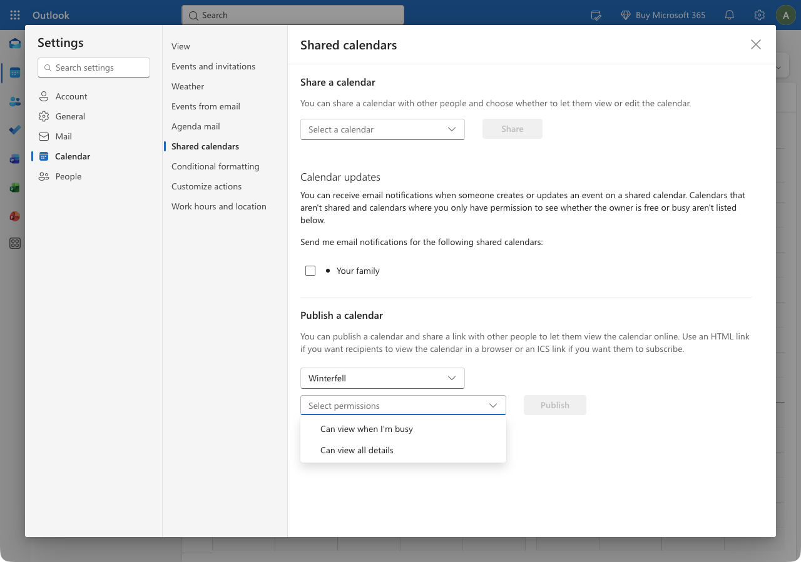
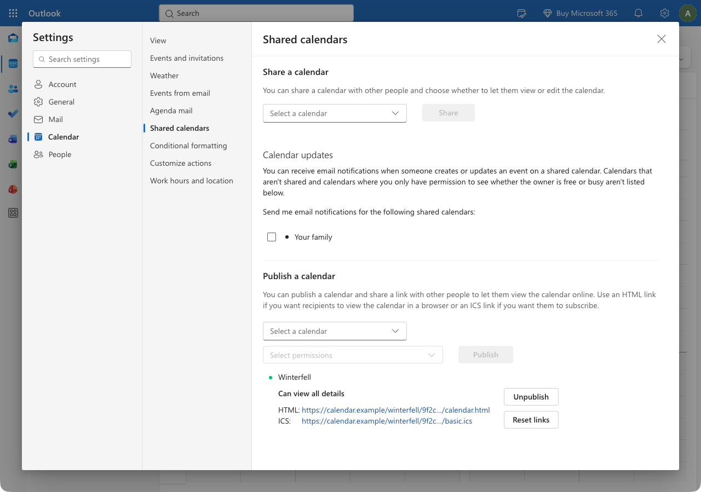
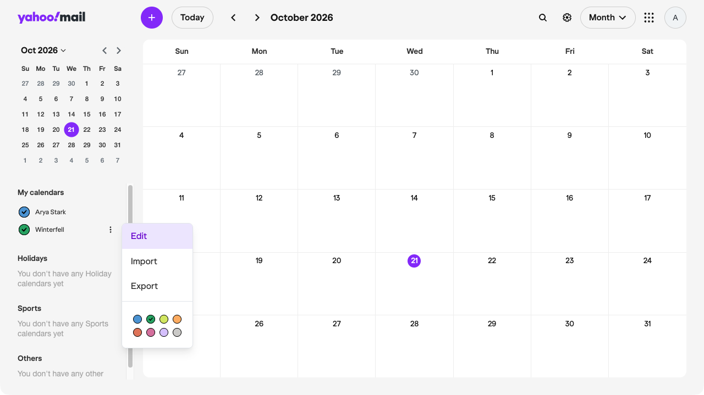
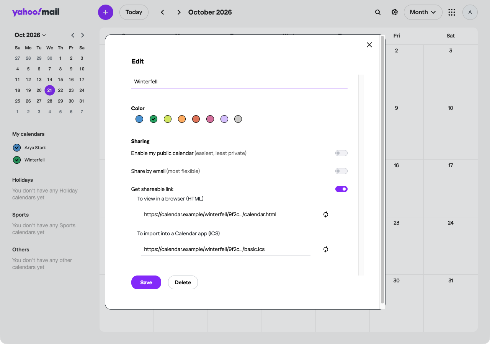

# Get an iCal link for your calendar

Tolon reads your calendar through an iCal link (a web address that ends in `.ics`). Every calendar service can give you one. This page shows where to find it in Outlook.com, Google Calendar and Yahoo Calendar.

The link is private. Anyone who has it can read your calendar, so paste it into Tolon and nowhere else. If it ever leaks, reset it in the same place you found it. Tolon only reads the link. It never writes to your calendar.

The screenshots show a test account. Your own names and addresses appear in their place.

## Outlook.com

1. Open [outlook.live.com/calendar](https://outlook.live.com/calendar) and sign in.
2. Click the gear icon at the top right. Settings opens.
3. In the left column, click Calendar. In the middle column, click Shared calendars.
4. Scroll down to Publish a calendar. Under Select a calendar, choose the calendar you want in Tolon.

   

5. Under Select permissions, choose Can view all details, so Tolon gets the meeting titles and join links. The other option, Can view when I'm busy, hides the titles.

   

6. Click Publish. The calendar appears under the pickers with an HTML link and an ICS link. Copy the ICS link.

   

The ICS link is private. Anyone who has it can read the calendar. Unpublish stops the link working; Reset links makes new ones and stops the old ones working. Use either if the link ever leaks, then publish again and give Tolon the new link.

## Google Calendar

1. Open [calendar.google.com](https://calendar.google.com) and sign in.
2. Click the gear icon at the top right, then click Settings.

   

3. In the left column, under Settings for my calendars, click the calendar you want in Tolon.
4. Scroll down to Integrate calendar.
5. Find Secret address in iCal format. Click the copy icon next to it. If the address is hidden behind dots, click the eye icon first.

   

Use the secret address, not the public one. The public address only works if the calendar is public. The Reset button under the secret address makes a new one and stops the old one working. Use it if the link ever leaks.

## Yahoo Calendar

1. Open [calendar.yahoo.com](https://calendar.yahoo.com) and sign in.
2. In the left column, under My calendars, move the pointer over the calendar you want in Tolon and click the three dots that appear next to its name. A menu opens.

   

3. Click Edit. The Edit dialog opens with the calendar name, colours and a Sharing section.
4. Under Sharing, turn on Get shareable link. Two links appear: one to view in a browser (HTML) and one to import into a calendar app (ICS). Copy the ICS link. Leave Enable my public calendar off; it makes the calendar visible to everyone.

   

5. Click Save.

The ICS link is private. Anyone who has it can read the calendar. Turning Get shareable link off stops the link working, and the reset icon next to each link makes a new one and stops the old one working. Use either if the link ever leaks, then give Tolon the new link.

## Paste the link into Tolon

1. Open Tolon. On the first run, the first-run window asks for a calendar. Later, open Settings, Calendars and click Add calendar.
2. Paste the link into Paste an iCal link and confirm.

Tolon fetches the calendar right away and shows the next meeting in the tray panel. If it reports an error, check that the link starts with `https://` or `webcal://` and ends in `.ics`, and that you copied all of it.
