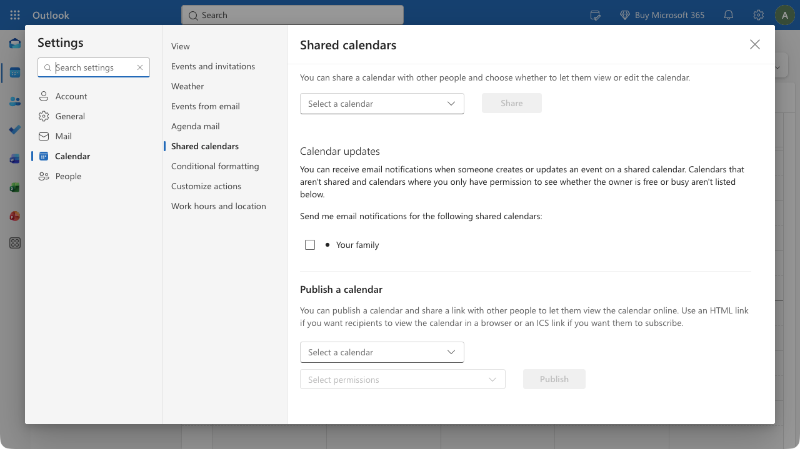
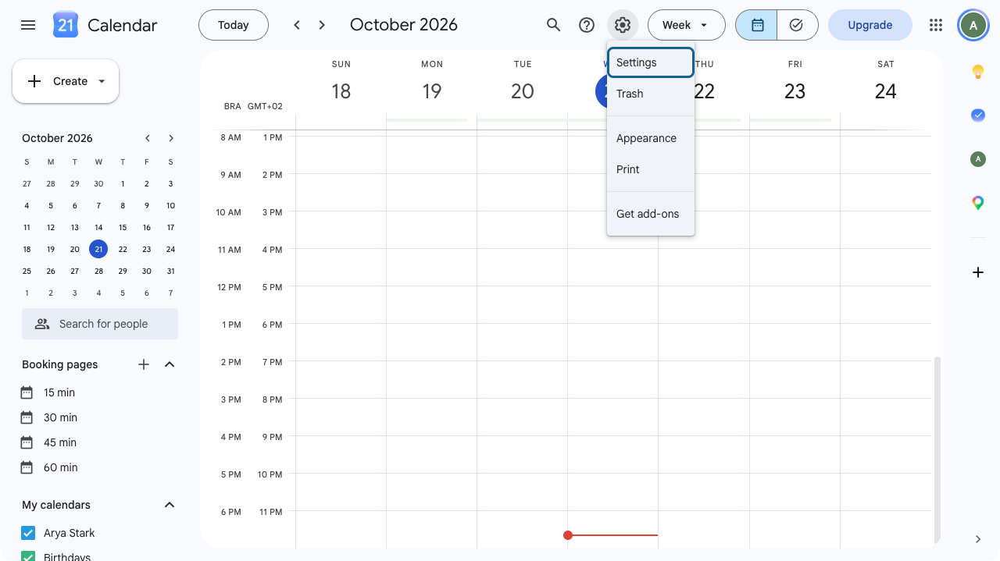
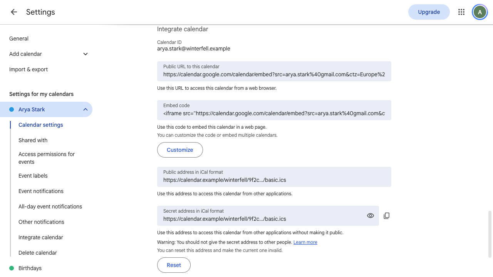
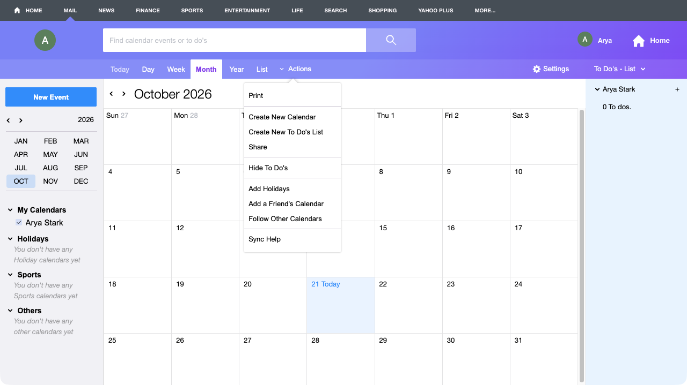

# Get an iCal link for your calendar

Tolon reads your calendar through an iCal link (a web address that ends in `.ics`). Every calendar service can give you one. This page shows where to find it in Outlook.com, Google Calendar and Yahoo Calendar.

The link is private. Anyone who has it can read your calendar, so paste it into Tolon and nowhere else. If it ever leaks, reset it in the same place you found it. Tolon only reads the link. It never writes to your calendar.

The screenshots show a test account. Your own names and addresses appear in their place.

## Outlook.com

1. Open [outlook.live.com/calendar](https://outlook.live.com/calendar) and sign in.
2. Click the gear icon at the top right. Settings opens.
3. In the left column, click Calendar. In the middle column, click Shared calendars.
4. Scroll down to Publish a calendar. Under Select a calendar, choose the calendar you want in Tolon. Under Select permissions, pick the level that shows all details, so Tolon gets the meeting titles and join links.

   

5. Click Publish. Outlook shows an HTML link and an ICS link under the pickers. Copy the ICS link.

The ICS link is private. Come back to this section to stop publishing if the link ever leaks, then publish again to get a new one.

The guide stops at the Publish button because that click changes what your account shares. No screenshot of the links is shown for that reason.

## Google Calendar

1. Open [calendar.google.com](https://calendar.google.com) and sign in.
2. Click the gear icon at the top right, then click Settings.

   

3. In the left column, under Settings for my calendars, click the calendar you want in Tolon.
4. Scroll down to Integrate calendar.
5. Find Secret address in iCal format. Click the copy icon next to it. If the address is hidden behind dots, click the eye icon first.

   

Use the secret address, not the public one. The public address only works if the calendar is public. The Reset button under the secret address makes a new one and stops the old one working. Use it if the link ever leaks.

## Yahoo Calendar

1. Open [calendar.yahoo.com](https://calendar.yahoo.com) and sign in.
2. Click Actions in the toolbar above the calendar.

   

3. Click Share. A sharing dialog opens.
4. In the dialog, turn on sharing for the calendar you want in Tolon and copy the link labelled ICS.

The ICS link is private. The same dialog lets you reset the links, which stops the old ones working.

The guide stops at the Share menu item because the steps after it change what your account shares. No screenshot of the dialog is shown for that reason.

## Paste the link into Tolon

1. Open Tolon. On the first run, the first-run window asks for a calendar. Later, open Settings, Calendars and click Add calendar.
2. Paste the link into Paste an iCal link and confirm.

Tolon fetches the calendar right away and shows the next meeting in the tray panel. If it reports an error, check that the link starts with `https://` or `webcal://` and ends in `.ics`, and that you copied all of it.
