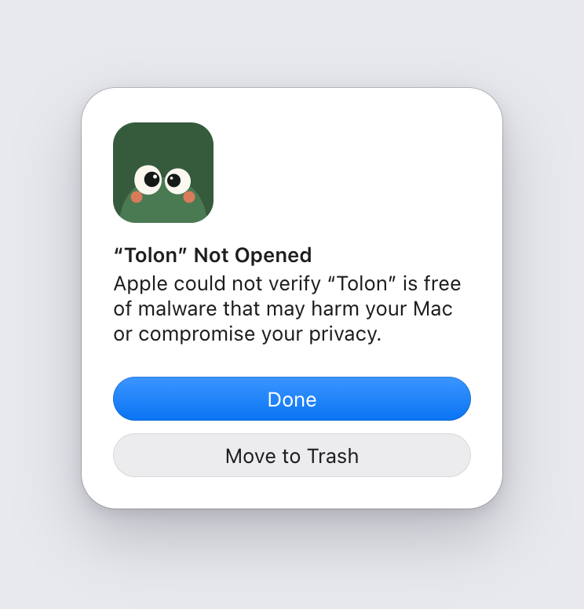
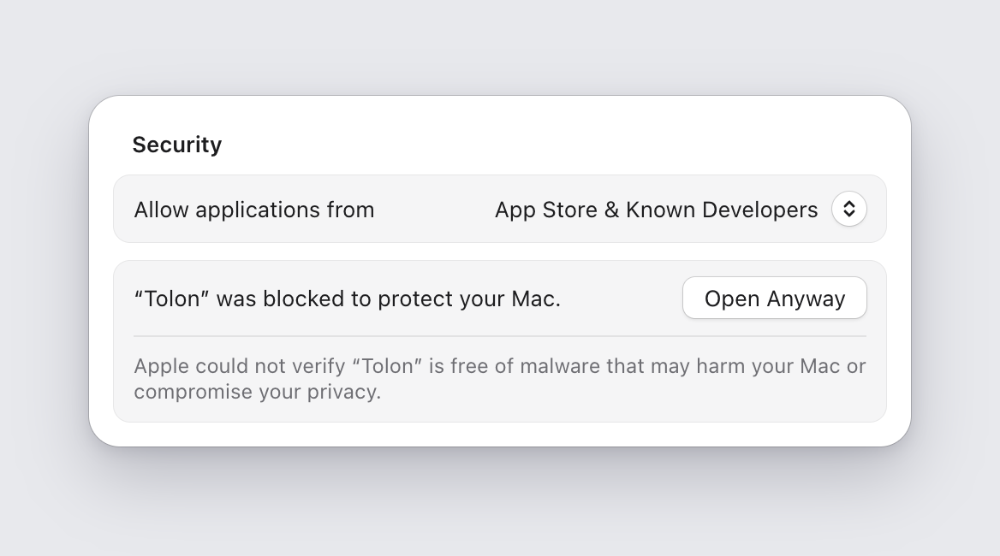

# Install Tolon

Tolon is a beta. Download the file for your system from the Assets list of the release, then follow the steps for your system below. It takes about two minutes, including your first calendar. Tolon only reads your calendars. It has no analytics and sends no data about you. It contacts your calendar links and GitHub, to check for updates.

The first-run window asks for an iCal link. [Get an iCal link for your calendar](help/ical-links.md) shows where to find it in Outlook.com, Google Calendar and Yahoo Calendar.

| System | File to download |
| --- | --- |
| macOS 13 Ventura or newer, Apple silicon and Intel | `Tolon_<version>_universal.dmg` |
| Windows | `Tolon_<version>_x64-setup.exe` (the betas have no `.msi`; it comes with 0.1.0) |
| Linux, built on Ubuntu 22.04 | `Tolon_<version>_amd64.AppImage` (any distribution) or `Tolon_<version>_amd64.deb` (Debian, Ubuntu) |

## macOS

Tolon is signed by its author, not by Apple, because the project has no paid Apple Developer membership. macOS therefore says it cannot check Tolon for malware. You approve it once.

1. Open the `.dmg` and drag Tolon into Applications.
2. Open Tolon from Applications. macOS shows a warning that it could not verify Tolon. Click Done. Do not click Move to Trash.

   

3. Open System Settings, click Privacy & Security, and scroll down to Security. Click Open Anyway next to Tolon. The button shows for about an hour after step 2. If it is gone, repeat step 2.

   

4. Type your Mac password and click OK. Your user name is usually already filled in. On a Mac with Touch ID, Touch ID may ask for your finger instead of the password. Tolon opens its first-run window. From now on Tolon opens like any other app.

   


If you prefer the Terminal, check the download against `SHA256SUMS` first (see "Check your download" below). Then run this line, which removes the quarantine mark that causes the warning:

```
xattr -dr com.apple.quarantine /Applications/Tolon.app
```

### Install from the Terminal

One line in the Terminal installs Tolon and skips the Open Anyway steps:

```
curl --proto '=https' --tlsv1.2 -fsSL https://github.com/danielpsf/tolon/releases/latest/download/install.sh | sh
```

The copy of `install.sh` on each release installs that release. Here is what it does, in order:

1. It stops unless this is a Mac.
2. It downloads the `.dmg` and `SHA256SUMS` of the release into a temporary folder.
3. It checks the `.dmg` against its line in `SHA256SUMS`. If the line is missing or the checksum does not match, it stops and deletes the download.
4. It opens the `.dmg` read-only at a temporary mount point.
5. It copies Tolon into `/Applications`, or into `Applications` in your home folder when you cannot write to `/Applications`. If Tolon is already installed and running, it quits Tolon first and then replaces it.
6. It tells you where Tolon is installed and opens it. Then it closes the `.dmg` and deletes the temporary folder.

It never asks for your password and never uses `sudo`.

To read the script before you run it, save it, look at it, and run the saved copy:

```
curl --proto '=https' --tlsv1.2 -fsSL https://github.com/danielpsf/tolon/releases/latest/download/install.sh -o install.sh
less install.sh
sh install.sh
```

macOS shows the Open Anyway warning for files that a browser downloads, because the browser marks them. `curl` does not mark the file, so macOS does not ask. The script checks the file itself instead. The checksum proves that the download is intact. It does not prove who built it, because the checksum comes from the same release as the file. Tolon is still signed by its author, not by Apple.

## Windows

1. Download the `.exe`. Your browser may block it as "not commonly downloaded". In Edge or Chrome, open the downloads list, click the three dots next to the file, choose Keep, then choose Keep anyway.
2. Double-click the file.
3. Windows may show "Windows protected your PC". Tolon is not yet signed by a certificate authority, so Windows does not know the publisher. Click More info, then click Run anyway.
4. Follow the installer. Tolon opens its first-run window.
5. After that, Tolon lives in the system tray at the bottom right. If you do not see its icon, click the small arrow to show hidden icons.

## Linux

AppImage, any distribution:

1. Make the file runnable. In a terminal, in the folder with the download, run the first line below. Or right-click the file, choose Properties, open Permissions, and turn on Allow executing as program.
2. Start it.

```
chmod +x Tolon_*.AppImage
./Tolon_*.AppImage
```

If it does not start and mentions FUSE, install the FUSE library once and try again:

- Ubuntu 22.04: `sudo apt install libfuse2`
- Ubuntu 24.04: `sudo apt install libfuse2t64`
- Fedora: `sudo dnf install fuse-libs`

Debian and Ubuntu, with the `.deb`:

```
sudo apt install ./Tolon_*_amd64.deb
```

Then start Tolon from your applications menu. It opens its first-run window.

The tray icon needs a panel that supports AppIndicator icons. KDE works out of the box. On GNOME, install the AppIndicator extension.

## Check your download

This step is optional. It proves the file was not changed on the way to you. Download `SHA256SUMS` from the same release into the same folder as your installer, then run one of these:

```
shasum -a 256 -c SHA256SUMS --ignore-missing      # macOS
sha256sum -c SHA256SUMS --ignore-missing          # Linux
```

On Windows, run `Get-FileHash <file>` in PowerShell and compare the result with the line for your file in `SHA256SUMS`.

## Updates

Tolon checks GitHub for a new version when it starts and then once a day. When it finds one, the tray panel shows a line about it, and Settings, About shows "Tolon <version> is available." with three buttons:

- Install and restart: Tolon downloads the update, checks it against the project's signing key, installs it and starts again. An update that does not match the key is never installed.
- Later: the message goes away until the next check.
- Skip this version: Tolon does not offer this version again. A newer version is offered as usual.

Nothing is installed until you click Install and restart. To check at once, click Check for updates in Settings, About.

- Windows: the installer shows a small progress window, then Tolon starts again. If you installed Tolon from the `.msi`, Windows asks for administrator approval first.
- Linux: an update of the `.deb` asks for your password. The AppImage replaces itself.
- macOS: if macOS warns again that it could not verify Tolon after an update, approve it once more with steps 2 to 4 above.

If an update fails, Tolon keeps running the version you have. You can always download the new file from the Releases page and install it over the old one.

## Troubleshooting

If Tolon does something wrong, such as an alarm that did not ring or a calendar that does not sync, save a diagnostics file: in Settings, About, under "Help us fix a problem", click Save diagnostics. Tolon saves a zip file on your computer and sends nothing. Then email the file to tolon@danielpsf.net and say what happened, or attach it to an issue on GitHub. [What the file holds, and what it never holds](help/diagnostics.md).

## Known limits

- macOS: the first start needs the Open Anyway step above. The Terminal install skips that prompt, because it checks the file itself.
- macOS: the alarm covers every screen and every desktop, and it sits above apps in full screen. It stays up when you switch desktops. Join, snooze or dismiss it to close it on all screens.
- Windows: Windows may not let Tolon take the keyboard from the program you are using. Tolon always shows the alarm on top. But Enter, Esc, D and Space may do nothing until you click the alarm or press Alt+Tab to it. The buttons always work. A program in full-screen mode, such as some games, may still draw over the alarm.
- Linux with Wayland: the system may not let Tolon cover the whole screen. Tolon then shows a notification with Join and Snooze and plays the alarm sound instead. Sessions that use X11 get the full-screen alarm.
- Linux: Tolon needs a graphical session.
- macOS: if the menu bar is full, macOS can hide Tolon's icon behind the notch. Open Tolon again from Finder or Spotlight to bring up its window, or make room in the menu bar.
- Windows: Windows can move Tolon's icon into the hidden icons. Click the small arrow next to the clock to show it, or start Tolon again from the Start menu to bring up its window.
- Linux: some panels hide tray icons, and GNOME shows none without the AppIndicator extension. Start Tolon again from your applications menu, or run the AppImage again, to bring up its window.
- On Linux, if Tolon was still closing, opening it again may fail once; open it again.
- macOS: after you join a call from the alarm, Tolon hands the keyboard to the app that opened the link. If that app cannot be found, the keyboard may stay with Tolon until you click the call window.
- Windows: if you turn Tolon off in Task Manager, under Startup apps, Windows keeps it off until you turn it on there again. The Start at login switch in Tolon cannot override that.
